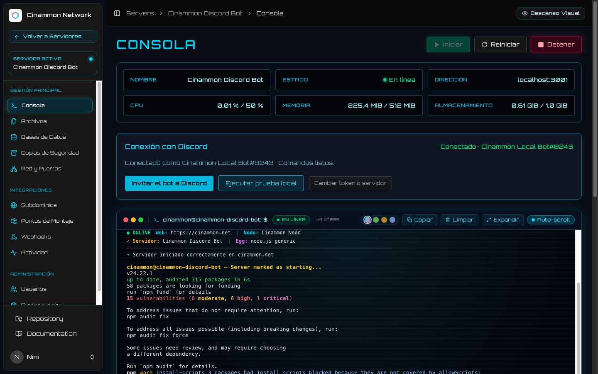
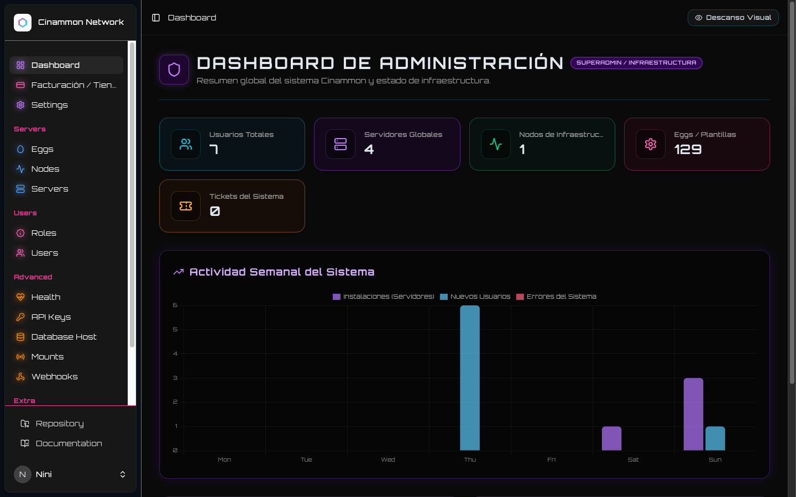
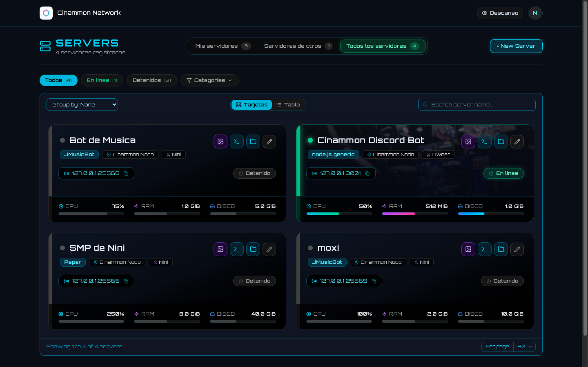
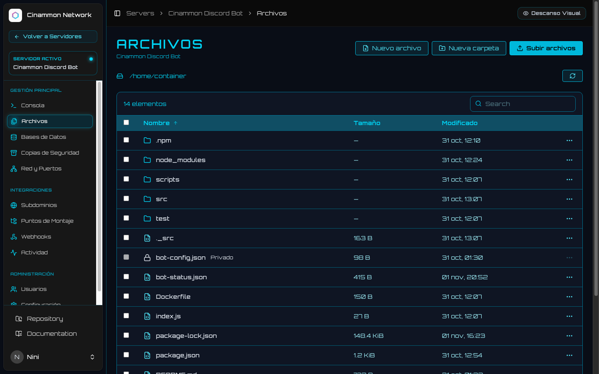
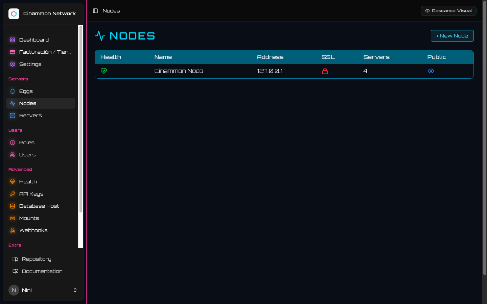
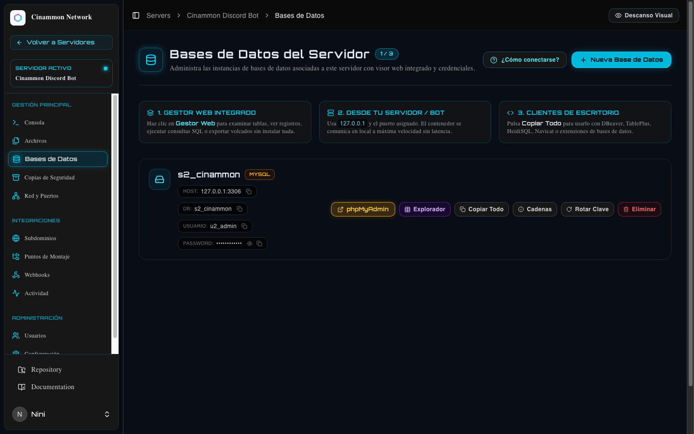
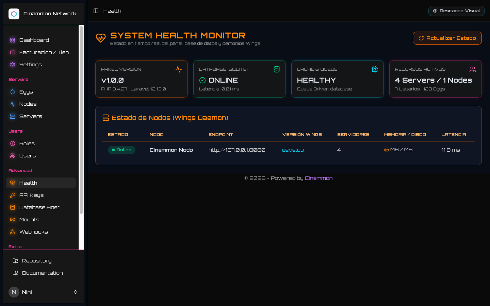
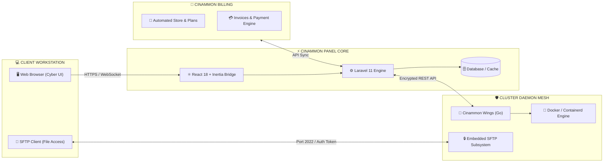

<p align="center">
  <pre align="center">
<font color="#00f7ff"><b>╔═╗╦╔╗╔╔═╗╔╦╗╔╦╗╔═╗╔╗╔  ╔╗╔╔═╗╔╦╗</b></font>
<font color="#a78bfa"><b>║  ║║║║╠═╣║║║║║║║ ║║║║  ║║║║╣  ║ </b></font>
<font color="#f472b6"><b>╚═╝╩╝╚╝╩ ╩╩ ╩╩ ╩╚═╝╝╚╝  ╝╚╝╚═╝ ╩ </b></font>
  </pre>
  <p align="center">
    <b><code>// NEXT-GEN CYBERPUNK GAME SERVER & CLOUD ORCHESTRATION PLATFORM //</code></b>
  </p>
  <p align="center">
    <a href="https://github.com/cinammon-net/panel"></a>
    <a href="https://github.com/cinammon-net/panel"></a>
    <a href="https://github.com/cinammon-net/panel"></a>
    <a href="https://github.com/cinammon-net/wings"></a>
    <a href="https://github.com/cinammon-net/panel/blob/main/LICENSE"></a>
  </p>
</p>

---

## ⚡ // 01. VISUAL INTERFACE & TELEMETRY

<div align="center">
  <p><b>🛰️ CYBER TERMINAL & REAL-TIME RUNTIME CONSOLE</b></p>
  
  <p><i>ASCII neon branding, ANSI live telemetry streaming, quick action chips, and gradient glowing bash input.</i></p>
</div>

<br />

<div align="center">
  <table width="100%">
    <tr>
      <td width="50%" align="center">
        <b>📊 CENTRAL TELEMETRY DASHBOARD</b><br /><br />
        <br />
        <sub>Monitoreo holístico de instancias, nodos y carga global en tiempo real.</sub>
      </td>
      <td width="50%" align="center">
        <b>🎮 SERVER FLEET MATRIX</b><br /><br />
        <br />
        <sub>Gestión multi-servidor con indicadores de estado, IP y asignación de recursos.</sub>
      </td>
    </tr>
    <tr>
      <td width="50%" align="center">
        <br /><b>📁 INTEGRATED MONACO FILE MANAGER</b><br /><br />
        <br />
        <sub>Editor Monaco con resaltado de sintaxis, compresión y subida segura sin salir del navegador.</sub>
      </td>
      <td width="50%" align="center">
        <br /><b>🌐 DAEMON NODES ORCHESTRATION</b><br /><br />
        <br />
        <sub>Orquestación de clústeres Wings, vinculación de puertos SFTP y certificados TLS.</sub>
      </td>
    </tr>
    <tr>
      <td width="50%" align="center">
        <br /><b>🗄️ MANAGED RELATIONAL DATABASES</b><br /><br />
        <br />
        <sub>Gestión de bases de datos MySQL/MariaDB con phpMyAdmin integrado, rotación de claves y cadenas de conexión.</sub>
      </td>
      <td width="50%" align="center">
        <br /><b>🩺 CLUSTER SYSTEM HEALTH & DAEMON LATENCY</b><br /><br />
        <br />
        <sub>Telemetría en tiempo real del clúster Wings, sockets de base de datos, colas y latencia round-trip.</sub>
      </td>
    </tr>
  </table>
</div>

---

## 🛰️ // 02. SYSTEM ARCHITECTURE



---

## 🔮 // 03. CYBERNETIC FEATURES

* **⚡ Cyber Terminal 2.0**: Consola ultra-rápida equipada con buffer de registros optimizado, coloreado semántico ANSI, barra de comandos rápidos (`/status`, `/test`, `/ping`, `/ayuda`, `/stop`), selector de temas (`cyan`, `matrix`, `sunset`, `hielo`) y prompt interactivo con glow degradado.
* **🛡️ Zero-Trust Security**: Aislamiento estricto de credenciales en backend. Tokens de daemon, claves de Discord Bot y credenciales de bases de datos jamás viajan en texto plano al frontend.
* **📁 Monaco Cloud IDE**: Gestor de archivos integrado con soporte para edición en vivo (archivos hasta 1 MiB), subidas de alto rendimiento (hasta 100 MiB), extracción segura en carpetas aisladas y prevención de enlaces simbólicos maliciosos.
* **🧬 Dynamic Egg & Blueprint Engine**: Compatible con el ecosistema de más de 129 plantillas oficiales de juegos, bases de datos y microservicios mantenidos por [Cinammon Eggs](https://github.com/cinammon-net/eggs).
* **📈 Resource Telemetry**: Gráficos dinámicos con métricas reales de uso de vCPU, memoria RAM dedicada, almacenamiento NVMe y ancho de banda de red.
* **🤖 Bot Gateway First-Class**: Integración nativa con bots de Discord (Gateway de eventos salientes, configuración segura de token 0600 y generación de enlaces de invitación con permisos restringidos).

---

## 🛠️ // 04. LOCAL RUNTIME & DEPLOYMENT

### Requisitos del Sistema
* **PHP**: 8.3+ con extensiones `pdo`, `mbstring`, `openssl`, `curl`, `zip`
* **Node.js**: 20+ con NPM / PNPM
* **Composer**: 2.7+
* **Motor de Contenedores**: Docker Engine 24+ / Lima VM en macOS

### Inicialización Rápida (Entorno de Desarrollo)

```bash
# 1. Clonar el repositorio
git clone https://github.com/cinammon-net/panel.git
cd panel

# 2. Instalar dependencias backend y frontend
composer install
npm install

# 3. Configurar entorno
cp .env.example .env
php artisan key:generate

# 4. Compilar assets con Vite
npm run build

# 5. Levantar el stack local
./local/dev start
```

### Control de Servidores Locales

```bash
# Estado general de la infraestructura y contenedores
./local/dev status

# Ver logs del servidor Minecraft Paper
./local/dev php local/paper-control.php logs

# Enviar comando de consola al Bot de Discord
./local/dev php local/discord-control.php test

# Detener el clúster local para liberar memoria
./local/dev stop
```

---

## ⚙️ // 05. CONFIGURACIÓN DEL NODO & WINGS

1. Configura `APP_URL` en el archivo `.env` del **Panel** con su URL accesible desde el nodo (ej. `https://panel.cinammon.net` o `http://localhost:8000`).
2. Actualiza la caché del framework:
   ```bash
   php artisan config:clear
   ```
3. Dirígete a la pestaña **Configuration File** del nodo creado en el Panel para descargar el archivo `config.yml` generado criptográficamente.
4. Despliega dicho `config.yml` en el directorio de configuración de Wings (`/etc/cinammon/config.yml` o el path asignado en tu nodo) y reinicia el servicio del daemon.

---

## 📡 // 06. ECOSYSTEM MATRIX

| Repositorio | Función | Stack Tecnológico |
| :--- | :--- | :--- |
| **[cinammon-net/panel](https://github.com/cinammon-net/panel)** | Orquestador principal, interfaz de administración y consola cyber | Laravel 11, React 18, Inertia.js, TailwindCSS |
| **[cinammon-net/billing](https://github.com/cinammon-net/billing)** | Portal de clientes, tienda de planes automatizada y pasarelas | Laravel 11, Inertia.js, TailwindCSS, Fortify 2FA |
| **[cinammon-net/wings](https://github.com/cinammon-net/wings)** | Daemon de alto rendimiento, comunicación WebSocket y SFTP | Golang 1.23, Docker Engine API, WebSockets |
| **[cinammon-net/eggs](https://github.com/cinammon-net/eggs)** | Catálogo de más de 129 plantillas de instalación y ejecución | Dockerfiles, Bash Scripts, JSON Blueprints |

---

<p align="center">
  <sub>Cinammon.net // Designed with Cyberpunk Aesthetic & Enterprise Precision // 2026</sub>
</p>
